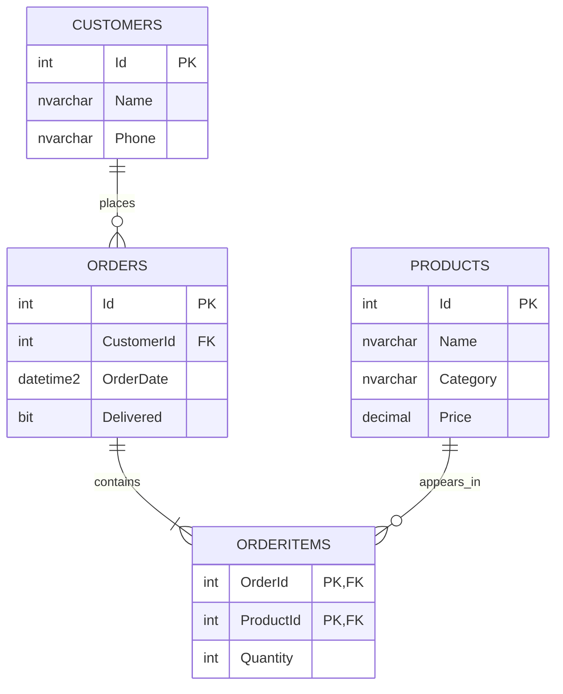

# Bakery Order Control - Third Version (OOP + SQL Server)

C# console application for a bakery that manages products, customers and orders.
Data is stored in a **SQL Server** database (`BakeryOrderControl`). The application creates the database and
its tables automatically the first time it runs.

## Data model



The full script is in [`docs/database_model.sql`](docs/database_model.sql).

## Structure
- `Models/`: `BaseEntity` (abstract), `Product`, `Customer`, `Order`
- `Database/`: `SqlServerDatabase` (connection, database and table creation)
- `Repositories/`: `IRepository<T>`, an in-memory version and a SQL Server version (`Repositories/SqlServer/`)
- `Services/`: business rules (`ProductService`, `CustomerService`, `OrderService`)
- `UI/`: `ConsoleHelper`, `MenuBase` and the menus that inherit from it, `App`
- `Exceptions/`: `BakeryException`

## Configuration
The connection string is in `UI/App.cs`. By default it uses SQL Server LocalDB (`(localdb)\MSSQLLocalDB`).
Change the `Server=` value if your SQL Server instance has another name.

## Run
```
dotnet run
```
